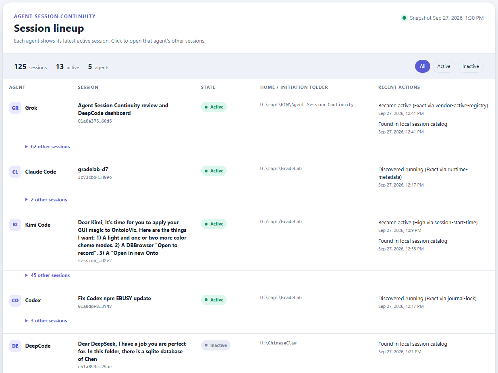

# Agent Session Continuity



Agent Session Continuity is a Windows-first continuity coordinator for local AI
coding CLIs. It inventories running conversations, records their durable
session identities and working directories, stops only sessions it can map,
updates the installed CLIs, and reopens the same conversations.

The lifecycle is:

```text
discover -> identify -> record -> confirm -> stop -> update -> resume -> audit
```

This repository is an early, reviewable release. Run `scan` before trusting
`cycle`, keep all agents idle during a cycle, and read the safety limitations.

## Status

- Version: `0.1.0`
- License: MIT
- Platform: Windows 10/11 with PowerShell 7+
- Maturity: alpha / independent review requested
- Affiliation: unofficial community project; not affiliated with or endorsed
  by OpenAI, Anthropic, Vegamo, or any other CLI vendor

## Supported adapters

| CLI | Session mapping | Update | Resume |
|---|---|---|---|
| Codex CLI | Windows Restart Manager plus local session metadata | `codex update` | `codex resume <id>` |
| Claude Code | PID runtime metadata plus journal-timestamp fallback | `claude update` | `claude --resume <id>` |
| Grok | Vendor active-session registry plus local session summaries | `grok update` | `grok --resume <id>` |
| Kimi Code | Local session index plus exact event-stream file lock | `kimi update -y` | `kimi --session <id>` |
| DeepCode CLI | Local project session index, resume arguments, or prior inventory | `npm install -g @vegamo/deepcode-cli@latest` | `deepcode --resume <id>` |

Codex documents `codex resume` and `codex update` as stable commands in its
[developer command reference](https://learn.chatgpt.com/docs/developer-commands).
Claude Code documents `--resume` and `claude update` in its
[CLI reference](https://code.claude.com/docs/en/cli-usage).
Grok documents its local session store, `--resume`, session-listing commands,
and `grok update` in the
[Grok CLI reference](https://docs.x.ai/build/cli/reference) and
[headless guide](https://docs.x.ai/build/cli/headless-scripting).
Kimi Code documents its metadata index and per-session `state.json`, as well
as `--session` and `kimi update`, in its
[session guide](https://www.kimi.com/code/docs/en/kimi-code-cli/guides/sessions),
[data-locations reference](https://www.kimi.com/code/docs/en/kimi-code-cli/configuration/data-locations.html),
and [command reference](https://www.kimi.com/code/docs/en/kimi-code-cli/reference/kimi-command.html).

Vendor-local metadata formats are not public compatibility contracts. The
adapters therefore fail closed: a running supported process without a durable
session mapping prevents the cycle.

## Quick start

1. Download or clone this folder on Windows.
2. Ensure `pwsh.exe` (PowerShell 7+) is on `PATH`.
3. Double-click `AgentSessionContinuity.bat` from Explorer.
4. Choose **Doctor** to inspect detected commands and data roots.
5. Choose **Scan**. Confirm every running session has a UUID and an `Exact`,
   `Tracked`, or `High` mapping. `Tracked` includes a matching process start
   time; `High` is emitted only when exactly one temporal candidate falls
   inside the adapter's matching window.
6. Wait until every agent is idle.
7. Choose **Cycle**, review the plan, and type `UPDATE` exactly.

Do not launch a cycle from inside a CLI session that will be stopped. The
coordinator checks its ancestry and refuses that topology; use Explorer or an
independent PowerShell window.

## Commands

```powershell
.\AgentSessionContinuity.bat doctor
.\AgentSessionContinuity.bat check
.\AgentSessionContinuity.bat scan
.\AgentSessionContinuity.bat list
.\AgentSessionContinuity.bat cycle
.\AgentSessionContinuity.bat restart 2
.\AgentSessionContinuity.bat restart checkout-refactor
.\AgentSessionContinuity.bat dashboard
.\AgentSessionContinuity.bat version
```

`restart` accepts a displayed list number, a full or partial UUID, or a full or
partial session name. PIDs are recorded for discovery and shutdown, but they
cannot be used for restoration because Windows assigns new PIDs after restart.

`cycle -Yes` bypasses the confirmation prompt. It is intended for deliberate
automation only and is not recommended during initial evaluation.

### Browser dashboard

`dashboard` refreshes the local inventory and opens a browser panel. Each agent
shows its latest active session, with that agent's other sessions behind a
click. Grok's,
Kimi Code's, and DeepCode's local metadata catalogs are imported so inactive
historical sessions appear on the first scan rather than only after this
utility has observed them running. Each row shows
the coding agent, session name and shortened ID, active/inactive state, home or
initiation folder, and the most recent coordinator actions. Use
`dashboard -NoOpen` to regenerate the panel without launching a browser.

The action summaries describe discovery, update-cycle, stop, and resume events
performed or observed by this utility. The dashboard does not read or summarize
conversation messages. Its snapshot is generated locally with no web service
or network dependency.

## State and privacy

Runtime state is stored outside repositories by default:

```text
%LOCALAPPDATA%\AgentSessionContinuity\running-sessions.json
%LOCALAPPDATA%\AgentSessionContinuity\last-cycle.json
%LOCALAPPDATA%\AgentSessionContinuity\history.jsonl
%LOCALAPPDATA%\AgentSessionContinuity\AgentSessionContinuity.log
%LOCALAPPDATA%\AgentSessionContinuity\session-registry.json
%LOCALAPPDATA%\AgentSessionContinuity\session-dashboard.html
```

The coordinator records process IDs, session IDs/names, tool names, timestamps,
working directories, matching methods, session-file paths, versions, update
results, and recent coordinator actions. It does not intentionally copy
conversation messages. Session names and working-directory paths can still be
sensitive; protect the state directory accordingly and inspect it before
sharing diagnostics or the generated dashboard.

You can override the state and vendor data roots:

```powershell
.\AgentSessionContinuity.ps1 scan `
  -StateRoot D:\private\asc-state `
  -CodexHome D:\profiles\codex `
  -ClaudeHome D:\profiles\claude `
  -GrokHome D:\profiles\grok `
  -KimiHome D:\profiles\kimi-code `
  -DeepCodeHome D:\profiles\deepcode
```

`CODEX_HOME`, `CLAUDE_CONFIG_DIR`, `GROK_HOME`, and `KIMI_CODE_HOME` are honored
when present.

## Safety model

- `doctor`, `check`, `scan`, and `list` do not stop sessions.
- `cycle` prints the complete session plan and requires `UPDATE` unless `-Yes`
  was supplied.
- An unmapped supported process aborts the entire cycle before shutdown.
- Duplicate durable-session mappings abort the entire cycle before shutdown.
- The coordinator refuses to stop an ancestor process that hosts itself.
- Every process tree is fully prevalidated using PID plus process-start time.
  Termination uses acquired process objects, preventing a reused PID from
  substituting a different process after validation.
- Update failures are logged, command paths are rediscovered, and the
  coordinator still attempts to reopen every saved session. Individual restart
  failures do not prevent later sessions from being attempted.
- No rollback mechanism exists in v0.1.0.
- A model turn interrupted during process termination may be lost even when the
  saved conversation remains resumable. Run cycles only while agents are idle.

See [SECURITY.md](SECURITY.md), [architecture](docs/ARCHITECTURE.md), and the
[adapter contract](docs/ADAPTERS.md) before extending or deploying the tool.

## Tests

Run the dependency-free validation suite:

```powershell
pwsh -NoProfile -File .\tests\Run-Tests.ps1
```

The tests parse every PowerShell file, reject common machine-specific markers,
exercise strict-mode launch, process-start identity, temporal ambiguity,
version, empty-host scanning, dashboard generation, and the package structure.
They do not terminate processes, install packages, or contact vendor services.

## Scope and roadmap

Useful next steps include signed release packaging, pre/post version manifests,
health checks after restart, update rollback, graceful interruption protocols,
configuration-driven adapters, additional terminals, and non-Windows process
coordination. See [CHANGELOG.md](CHANGELOG.md) for the current release boundary.

## Review handoff

Independent reviewers should begin with
[docs/REVIEW_CHECKLIST.md](docs/REVIEW_CHECKLIST.md). The most important
questions are whether every identity mapping fails safely, whether any process
selection can overmatch, and whether restart behavior remains correct when a
vendor changes its local metadata format.

After review, [docs/PUBLISHING.md](docs/PUBLISHING.md) provides a short public
repository and `v0.1.0` prerelease checklist.
